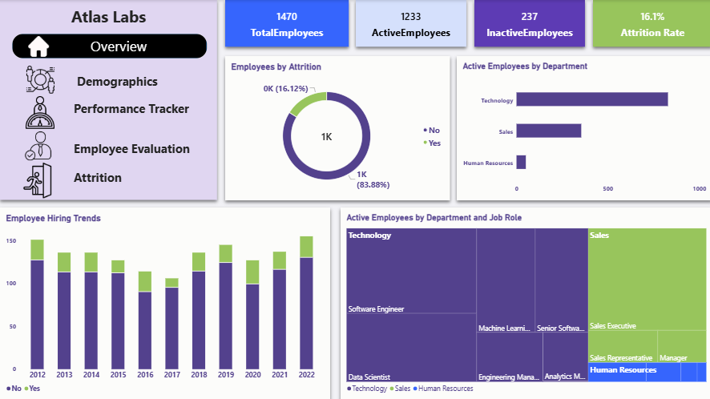
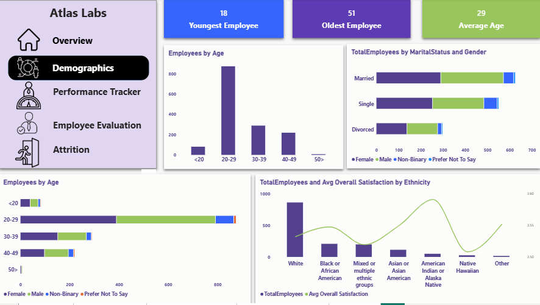
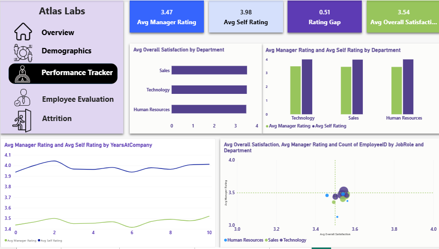
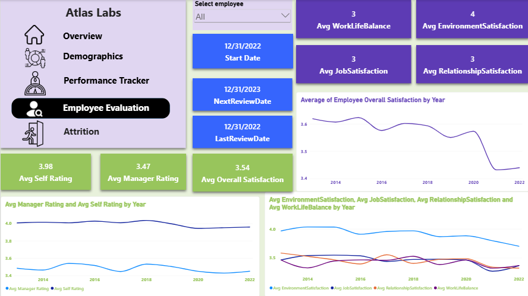
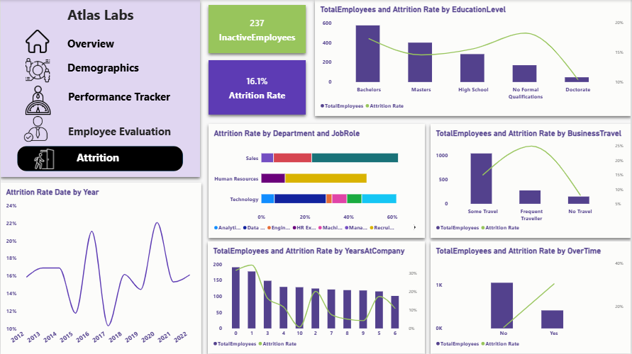
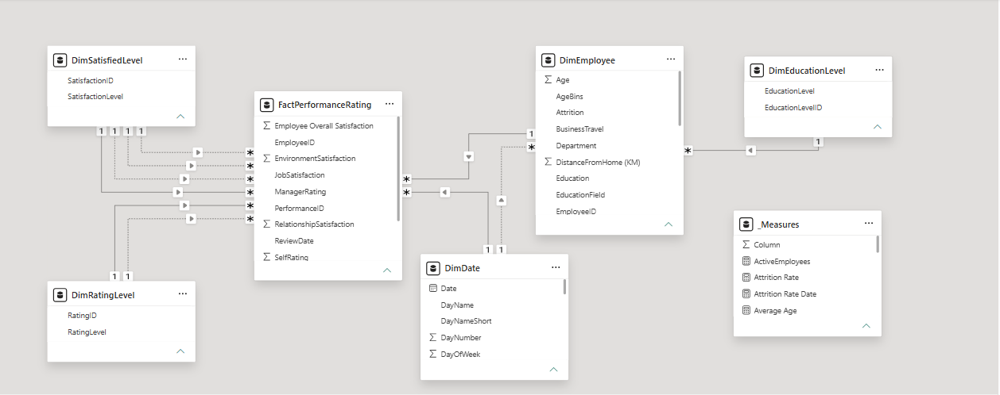

# 👥 Atlas Labs HR Analytics Dashboard

An interactive **Power BI** dashboard that analyzes employee attrition, demographics, performance, and satisfaction at **Atlas Labs**, built on the Atlas Labs HR dataset from Kaggle.

> 🔗 **Dataset:** [Atlas Labs HR Dataset on Kaggle](https://www.kaggle.com/datasets/mahmoudemadabdallah/hr-analytics-employee-attrition-and-performance)

---

## 📌 Project Overview

The goal of this project is to help HR and management understand **who is leaving the company, why, and where to act**. The report is organized into five pages:

| # | Page | What it answers |
|---|------|-----------------|
| 1 | **Overview** | Headcount, active vs. inactive employees, overall attrition rate, attrition by department and job role, and trend over time |
| 2 | **Demographics** | Age bins, gender, ethnicity, marital status, average/oldest/youngest employee, and how each relates to attrition |
| 3 | **Performance Tracker** | Self rating vs. manager rating (rating gap), overall satisfaction, and performance by department and years at company |
| 4 | **Employee Evaluation** | Per-employee drill-down (slicer by name): job, environment, relationship, and work-life-balance satisfaction, review dates, and rating trends |
| 5 | **Attrition** | Deep dive into attrition drivers: education level, business travel, overtime, tenure, gender, and trend by date |

## 📸 Screenshots

### Overview


### Demographics


### Performance Tracker


### Employee Evaluation


### Attrition


## 🧱 Data Model

Star schema with one fact table and several dimensions:




- **FactPerformanceRating**: performance reviews, self/manager ratings, satisfaction scores
- **DimEmployee**: employee attributes (department, job role, gender, age, ethnicity, marital status, overtime, travel, tenure, attrition)
- **DimDate**: date dimension for time analysis
- **DimEducationLevel**, **DimRatingLevel**, **DimSatisfiedLevel**: lookup tables
- **_Measures**: DAX measures table

### Key DAX Measures
`TotalEmployees`, `ActiveEmployees`, `InactiveEmployees`, `Attrition Rate`, `Average Age`, `Oldest Employee`, `Youngest Employee`, `Avg Self Rating`, `Avg Manager Rating`, `Rating Gap`, `Avg Overall Satisfaction`, `Avg JobSatisfaction`, `Avg EnvironmentSatisfaction`, `Avg RelationshipSatisfaction`, `Avg WorkLifeBalance`, `LastReviewDate`, `NextReviewDate`

## 🛠️ Tools

- Power BI Desktop (data modeling, DAX, visuals)
- Source data: Kaggle

## 📂 Repository Structure

```
Atlas-Labs-HR-Analytics/
├── report/
│   └── Atlas-Labs-HR-Dashboard.pbix
├── images/            # dashboard + data model screenshots
├── data/              # (optional) raw dataset files
├── .gitignore
└── README.md
```

## ▶️ How to Open

1. Install [Power BI Desktop](https://powerbi.microsoft.com/desktop/) (Windows).
2. Download `report/Atlas-Labs-HR-Dashboard.pbix`.
3. Open it in Power BI Desktop. If refresh fails, point the data source to your local copy of the dataset from Kaggle.

## 💡 Key Insights

- **1,470 employees** in total: 1,233 active and 237 inactive, an overall **attrition rate of 16.1%**.
- **Technology** is the largest department, followed by Sales and Human Resources.
- The workforce is young: ages range from **18 to 51**, with an **average age of 29**, and most employees are in the 20–29 group.
- Managers rate employees lower than employees rate themselves (**3.47 vs 3.98**, a rating gap of **0.51**), consistently across all departments.
- Average overall satisfaction is **3.54** and is very similar across departments, but it shows a downward trend in recent years.
- Attrition is higher among employees who **travel frequently** and those who work **overtime**.
- The attrition rate changes noticeably from year to year, with peaks around 2016 and 2020.

## 👤 Author

**YOUR NAME** · [LinkedIn](https://www.linkedin.com/in/batool-abd-alrzag-ab472424a/) · [GitHub](https://github.com/batolabdo9-wq)
